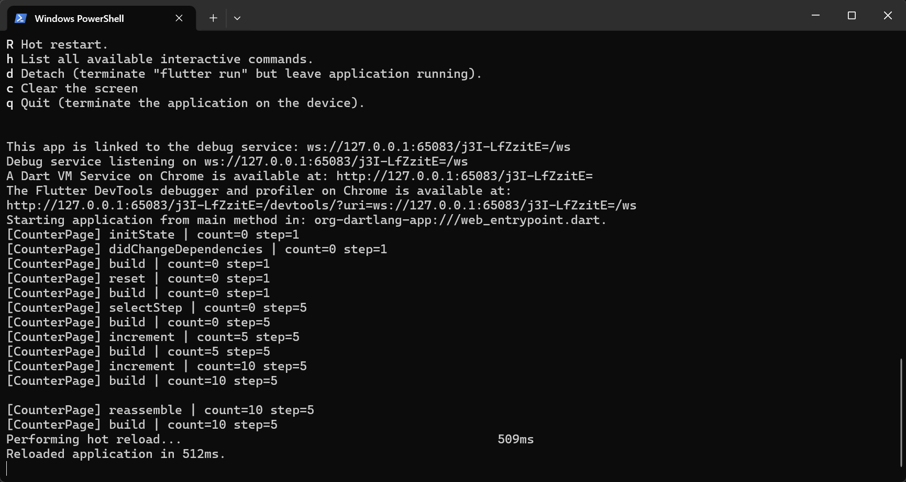
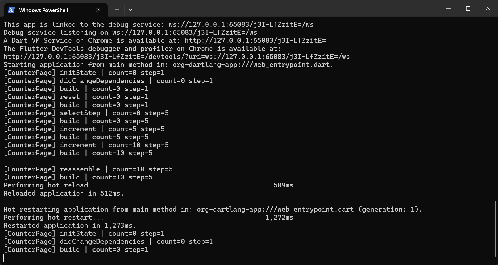
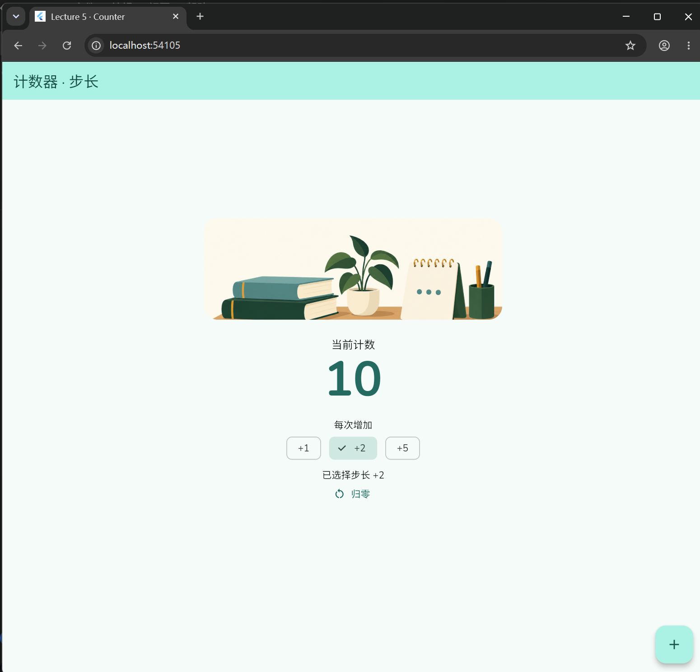
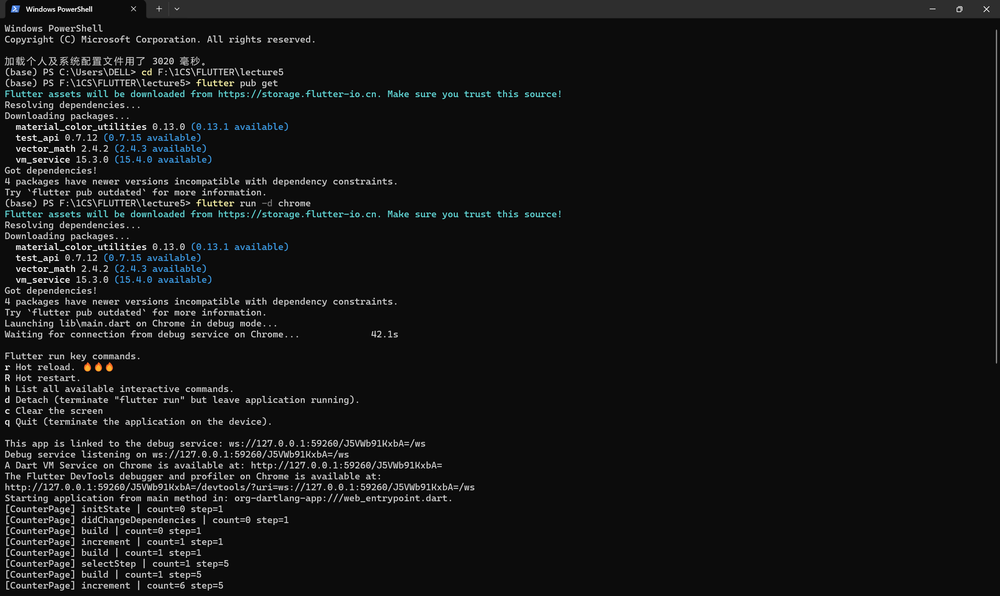
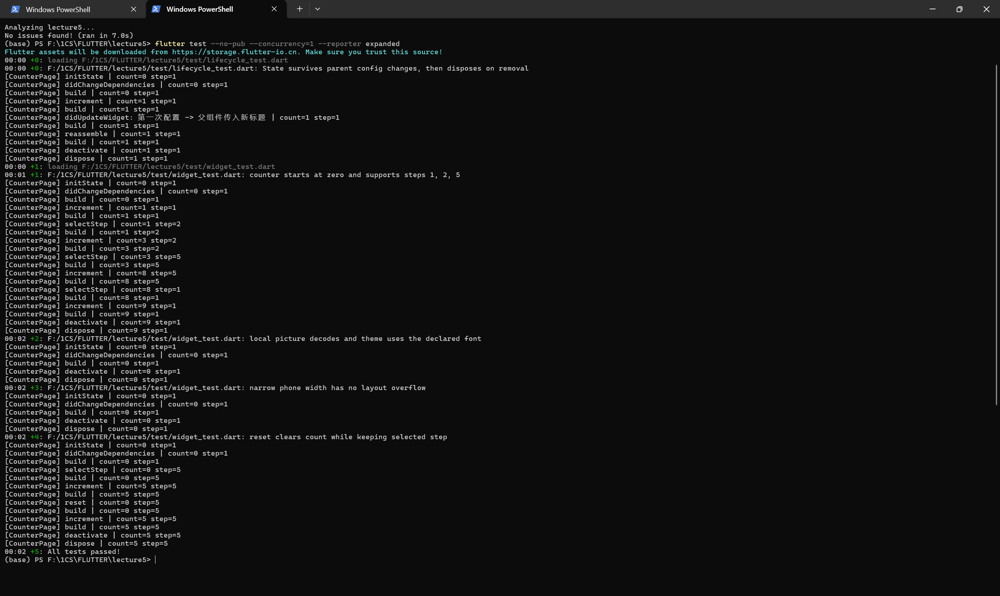
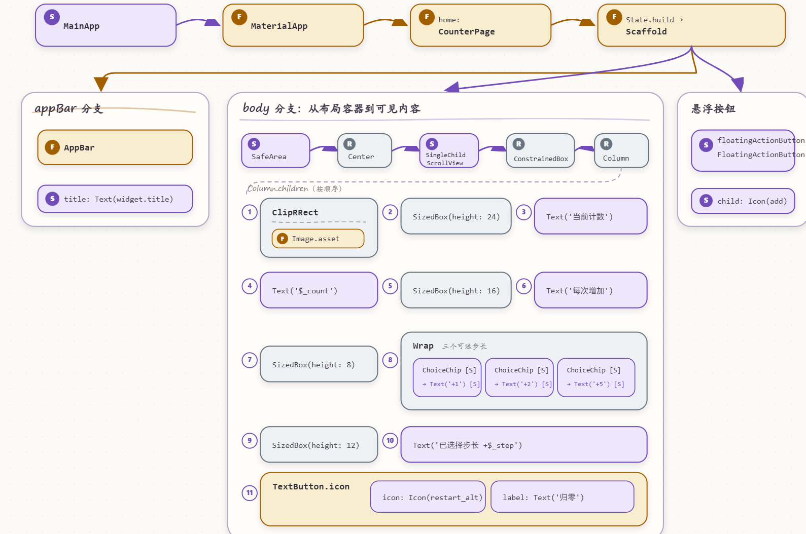

# 课堂实践进度报告五

主题：Flutter 工程结构与 Widget 体系

## 一、任务理解

这次要把计数器改造成一个可以选择步长的页面，完成主题、字体和图片配置，并记录 State 的生命周期。除了程序能运行，还要画出实际页面的 Widget 树，说明点击加号后数据和界面如何变化。

我按“先有可运行的结果，再逐项验证”的顺序整理作业。代码、测试和报告草稿有 TRAE 辅助，

## 二、环境与工具

- 系统：Windows；项目目录：`F:\1CS\FLUTTER\lecture5`。
- Flutter：3.47.4 stable；Dart：3.13.3。版本取自本机 SDK 信息。
- 已自证目标：Flutter Widget 测试、Web release 构建，以及本机浏览器中的页面交互。

## 三、过程记录

1. 参考 counter\_deep 的计数和步长思路。
2. 在 State 中保留 `_count`、`_step`，实现 +1/+2/+5 选择，并加入归零功能。步长选项移到正文，给窄屏保留空间。
3. 配置 teal 种子色、Nunito 字体和本地图片，并在页面中读取主题颜色及文字样式。
4. 加入 initState、didChangeDependencies、didUpdateWidget、build、reassemble、deactivate、dispose 日志；增加自动测试。
5. 验证发现测试调度及中文路径分析问题，修复测试并在最终英文路径复验

## 四、关键代码

第一段：改变计数。

```dart
void _inc() {
  setState(() {
    _count += _step;
  });
  _log('increment');
}
```

第 1 行定义按钮回调；第 2 行调用 State 的 setState，提供同步执行的修改函数；第 3 行将当前步长加到计数上；第 4 行结束回调，框架会安排关联部分重建；

第二段：读取主题并描述当前数字。

```dart
final colors = Theme.of(context).colorScheme;
final textStyles = Theme.of(context).textTheme;
Text(
  '$_count',
  key: const Key('count'),
  style: textStyles.displayLarge?.copyWith(
    color: colors.primary,
    fontSize: 72,
    fontWeight: FontWeight.w700,
  ),
)
```

第三段：声明资源。

```yaml
flutter:
  uses-material-design: true
  assets:
    - assets/images/study_desk.png
  fonts:
    - family: Nunito
      fonts:
        - asset: assets/fonts/Nunito.ttf
```

## 五、检查点结果

5 项测试全部通过；静态分析显示 No issues found；Web 构建成功。浏览器中已验证：初值为 0，选择 +5 后仍为 0，点击两次加号后为 10，图片和中文正常显示。

Widget 树：最终结构参考在 `docs/widget-tree.md`，自动参考图在 `docs/widget-tree.svg`；S/F 表示 StatelessWidget/StatefulWidget

## 六、问题与调试

暂无

## 七、AI 使用记录

| 工具或来源           | 实际用途          | 输出              | 验证方式          |
| --------------- | ------------- | --------------- | ------------- |
| 老师counter\_deep | 案例参考          | 计数、步长及基础日志思路    | 与教师源码快照对照     |
| AI 图像工具         | 制作本地资源        | study\_desk.png | 图片解码测试和实际页面显示 |
| Trae            | 部分指导以及md部分的写作 | 主要是md           | <br />        |

## 八、证据截图













## 九、自评

代码方面已具备步长控制、主题与字体配置、两处 Theme.of、本地图片和生命周期日志；自动检查及 Web 构建通过。

本人手绘图、r/R 对照、Trae 使用记录、复核和 Git 推送完成完成。目前对 State 与 build 的理解还需要后续复盘

## 十、一句话收获与下一步计划

目前需要抓住的一点：计数保存在 State 里，build 读取它来描述界面，修改变量和通知界面重建是两个不同动作。
